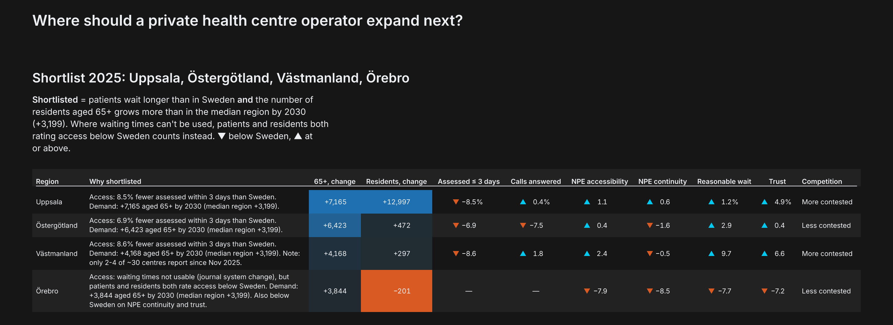
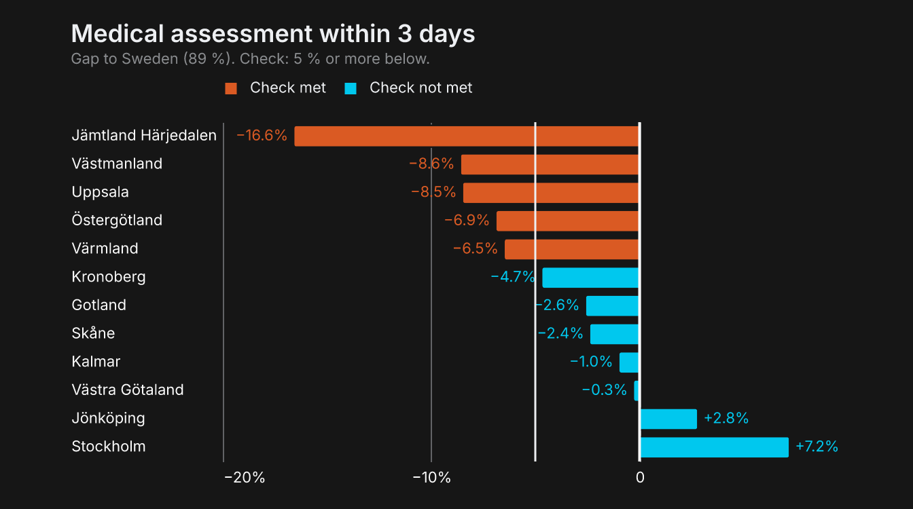
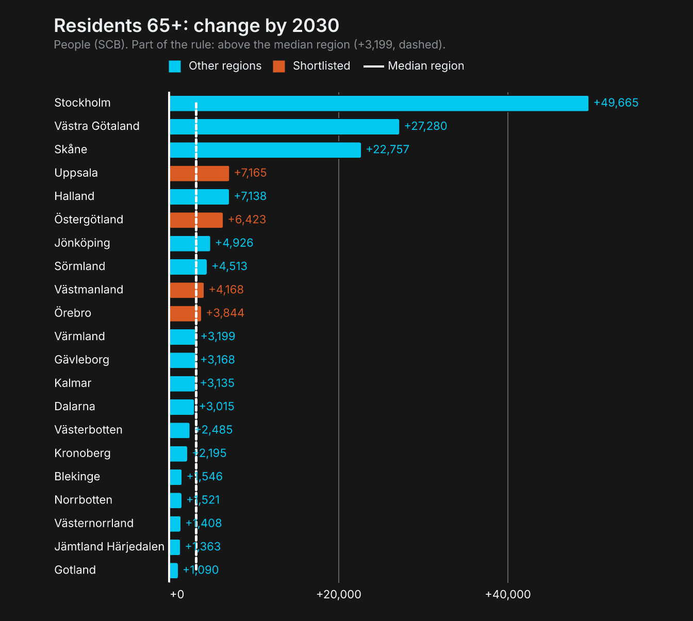
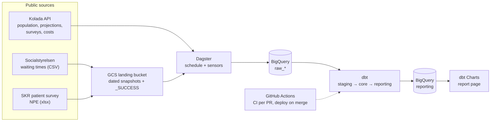

# Where should a private primary care chain open its next centres?

An end-to-end analytics project on live, public Swedish primary care data: automated ingestion, a tested
dbt model on BigQuery, and a one-page decision report for a strategy director.

[](https://edinaschmidt.github.io/se-healthcare-analytics/)

**[Open the full report](https://edinaschmidt.github.io/se-healthcare-analytics/)** · [PDF](docs/report.pdf)

## The answer (2025 data)

**Shortlist: Uppsala, Östergötland, Västmanland and Örebro.** These are the regions where patients wait
longer than in the rest of Sweden *and* the number of residents aged 65+ grows more than in the median region
by 2030.

- **Access.** Uppsala, Östergötland and Västmanland assess 6.9–8.6 percentage points fewer patients within
  3 days than Sweden (89 %), the benchmark set by the care guarantee (*vårdgaranti*).
- **A region the waiting times can't judge.** Örebro's waiting-time data is unusable during a journal system
  change, but patients (national patient survey) and residents (*Hälso- och sjukvårdsbarometern*) both rate
  access below Sweden, so it qualifies on that evidence.
- **Demand is the bigger story.** Stockholm alone adds about 50,000 residents aged 65+ by 2030, roughly
  28 health centres' worth of today's older patients, but it has no access gap, so it isn't shortlisted.

The audience is a (fictional) director of strategy at a private chain with a few dozen centres, who needs a
defensible shortlist of two or three regions for the board.

| Where access is worst | Where older residents grow most |
|---|---|
|  |  |

## How it works



- **Ingestion (Dagster).** Kolada is pulled monthly from its API. The waiting-time and survey files are
  downloaded by hand, dropped into a GCS bucket as dated snapshots, and loaded by a sensor once a snapshot is
  complete. Every load is a full, idempotent refresh, and dbt models rebuild automatically when their sources
  change.
- **Modelling (dbt on BigQuery).** 14 models in three layers. Staging cleans each source; core holds facts and
  dimensions per region and year; reporting has two flat, contract-enforced marts: region × year metrics with
  a national benchmark, and the shortlist with its rule.
- **Quality.** 132 data tests, including 8 custom SQL tests (for example, regional totals must add up to the
  national figure, and a shortlist flag must be empty when its input is missing). Plus 10 Python unit tests
  for the parsers and API client.
- **CI/CD.** Every pull request builds and tests only the changed models in its own BigQuery dataset, reading
  unchanged models from production. Merging to `main` rebuilds production. No service account keys anywhere:
  GitHub Actions authenticates through Workload Identity Federation, and local runs impersonate service
  accounts.
- **Report (dbt Charts).** The page is YAML and SQL in [`dbt_project/charts/expansion.yml`](dbt_project/charts/expansion.yml),
  reading only the production reporting tables.

## Decisions worth pointing out

- **Missing is not zero.** Suppressed values in the sources ("X", soft hyphens, "N") become `NULL` with the
  reason kept. Every shortlist flag is TRUE, FALSE or *can't be judged*, and a region is never counted as
  passing a check it couldn't be tested on.
- **Unreliable data is excluded, not ranked.** Nine regions are changing journal systems, so their
  waiting-time data is flagged and left out of the comparison and of the national benchmark, matching how
  Socialstyrelsen calculates its national figure. For these regions the access gap falls back on two
  independent surveys agreeing.
- **Uncertainty is respected.** A region is "clearly below" Sweden on the patient survey only if its whole
  confidence interval lies below Sweden's, and the charts draw both intervals.
- **Demand in people, not percent.** A new centre needs listed patients, so demand is the projected increase
  in residents aged 65+ (the heaviest users of primary care), measured against the median region. Population
  projections are published every few years; the latest one is carried forward and measured from its base year.
- **Every pick is explained.** The rule lives in one tested model, and the report prints a rule-based reason
  for each shortlisted region.

## Data

| Source | What is used | Grain | Load |
|---|---|---|---|
| [Socialstyrelsen](https://www.socialstyrelsen.se/) | Calls answered the same day; medical assessment within 3 days | Health centre × month, from July 2025 | Manual CSV snapshot → GCS → sensor |
| [SKR](https://skr.se/), Nationell patientenkät | Accessibility and continuity scores with confidence intervals | Region / municipality / health centre, 2025 | Manual xlsx snapshot → GCS → sensor |
| [Kolada](https://www.kolada.se/) (RKA) | Population and SCB 5-year projections, Care Need Index, *Hälso- och sjukvårdsbarometern*, purchased-care share, net cost | Region × year, 2020 onwards | API, monthly schedule |

## Repository

```
.github/workflows/   dbt CI (per PR), deploy (on merge), CI dataset cleanup
dagster_project/     ingestion: Kolada API client, GCS snapshot loaders, sensors, dbt assets
dbt_project/
  models/            staging → marts/core → marts/reporting
  seeds/             region mapping, translations, projection metadata
  tests/             custom SQL tests
  charts/            the report (dbt Charts)
docs/                the rendered report (GitHub Pages), PDF and README images
infra/               one-time Workload Identity Federation setup
```

## Run it yourself

You need a Google Cloud project with BigQuery, the `gcloud` CLI, [uv](https://docs.astral.sh/uv/), the
[dbt](https://docs.getdbt.com/) Fusion CLI and [dbt Charts](https://docs.dbtcharts.com/). From the
repository root:

```bash
gcloud auth application-default login

# ingestion: copy dagster_project/.env.example to .env and fill it in, then
(cd dagster_project && uv sync && uv run dg dev)

# models and tests
(cd dbt_project && dbt deps && dbt build)

# the report, served locally
(cd dbt_project && dct serve)
```

## Limitations and next steps

- The waiting-time series starts in July 2025, so 2025 covers six months; the comparison will firm up with
  a full year.
- Thresholds (5 and 10 percentage points, the median for demand) are judgement calls, stated on the page.
- Health-centre counts come from a one-off analysis
  ([`analyses/health_centre_load.sql`](dbt_project/analyses/health_centre_load.sql)), not yet from the
  models.
- Costs are nominal; a CPI adjustment would allow real-terms comparisons.
- On the dark theme, the report's "Highlight region" dropdown is hard to read (a dbt Charts styling bug).
